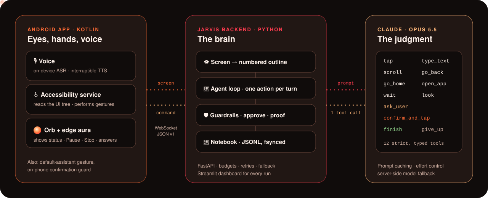
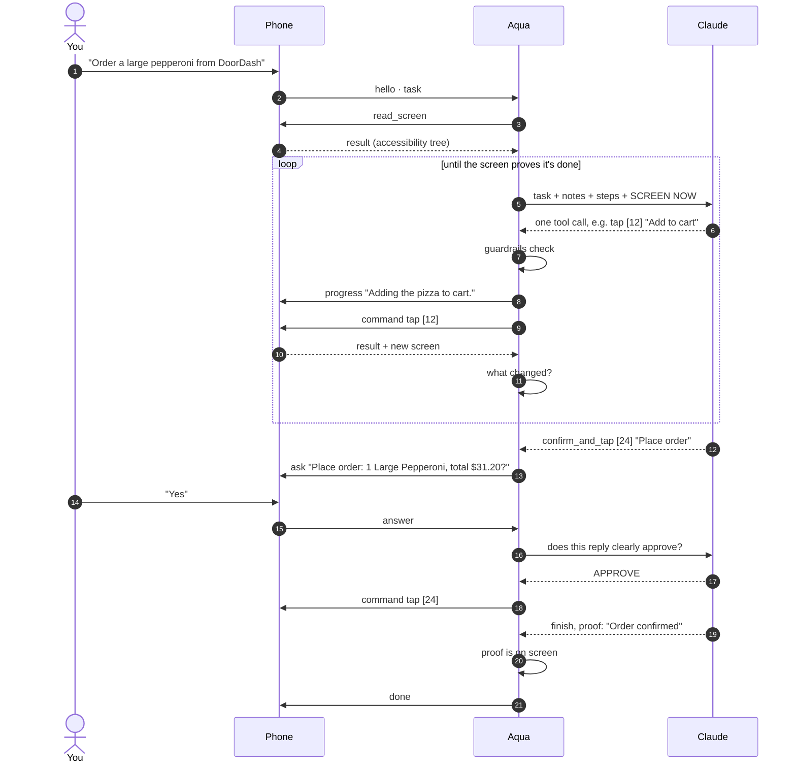

<div align="center">



<br/>

<a href="#the-problem"></a>
<a href="#how-it-works"></a>
<a href="android-client"></a>
<a href="backend"></a>
<a href="#voice-that-feels-like-a-conversation"></a>

<h3>An AI agent that uses your phone the way you do: it reads the screen, taps, types and scrolls,<br/>across any app, until the job is done and it can prove it.</h3>

<p><i>Built so that everyone can use a smartphone, including people who can't see it, can't easily touch it,<br/>or can't keep up with it.</i></p>

<a href="#the-problem"><b>The problem</b></a> ·
<a href="#built-for-the-people-phones-leave-behind"><b>Who it's for</b></a> ·
<a href="#watch-it-work"><b>Demo</b></a> ·
<a href="#how-it-works"><b>How it works</b></a> ·
<a href="#built-to-be-trusted"><b>Safety</b></a> ·
<a href="#architecture"><b>Architecture</b></a> ·
<a href="#run-it-yourself"><b>Run it</b></a>

</div>

<br/>

## The problem

**Your phone can do almost anything, but you have to tap through every step yourself.**

Ordering dinner, texting a friend that you're late, booking a ride, paying someone back: every one of these
means unlocking, finding the app, hunting through menus, closing popups and tapping a dozen times. It needs
your eyes and both hands the whole time.

"Smart" assistants were supposed to fix this. They don't, because they only work where an app developer built
an integration for them. Ask one to order from the restaurant app you actually use, and you get a web search.
**Most of the apps on your phone are invisible to your assistant.**

<div align="center">

</div>

> [!IMPORTANT]
> **The insight:** every app already describes itself to Android, through the same accessibility layer screen
> readers use. If an AI can read that and act on it, it can work in **any app, with zero integration**. No API,
> no partnership, no waiting for developers. That's Aqua.

<br/>

## Built for the people phones leave behind

Smartphones are how we bank, see a doctor, order groceries, call a ride and stay in touch with family. But they're
designed for people who can **see** a small screen, **tap** precisely, and **keep up** with constant redesigns.
Hundreds of millions of people can't do all three, and every year more of daily life moves onto the phone.

<div align="center">

<br/><sub>Sources: WHO fact sheets on <a href="https://www.who.int/news-room/fact-sheets/detail/disability-and-health">disability</a>, <a href="https://www.who.int/news-room/fact-sheets/detail/blindness-and-visual-impairment">vision impairment</a> and <a href="https://www.who.int/news-room/fact-sheets/detail/ageing-and-health">ageing</a>.</sub>
</div>

<br/>

> **Picture Ruth, 78.** Macular degeneration has blurred the middle of her vision, and arthritis makes small
> buttons hard to hit. Her prescription refill, her grocery order and video calls with her grandkids are all
> in apps she can barely use. Every time an app updates, she has to call her daughter for help.
>
> With Aqua, Ruth just says *"Reorder my groceries from last week."* Aqua shows each step in big, clear text,
> asks her one simple question out loud when it needs to, reads back the exact items and total, and only orders when she says
> **"Yes."** For the first time in years, she can do it herself.
>
> <sub>Ruth is an illustrative persona.</sub>

<table>
<tr>
<td width="33%" valign="top">

### Blind & low vision
**Today:** screen readers read the screen one item at a time. A single checkout can take dozens of swipes, and
an unlabeled button is a dead end.

**With Aqua:** say the goal, not the swipes. Aqua speaks at the moments that matter: its questions, the exact order before you approve it, and the result. When an icon has no label,
Aqua **looks at the screenshot** to work out what it is.

</td>
<td width="33%" valign="top">

### Older adults
**Today:** tiny text, buttons that move with every update, fear of tapping the wrong thing, and scams that
target them.

**With Aqua:** plain speech in, plain speech out. It reads back **exactly what it will buy and the total**
before it acts. Instructions hidden in messages and ads are ignored.

</td>
<td width="33%" valign="top">

### Motor disabilities
**Today:** Parkinson's tremors, ALS, arthritis, spinal cord injury or limb loss can make precise taps, swipes and
typing slow, painful or impossible.

**With Aqua:** your voice does the tapping, scrolling and typing. You start it with one gesture, and Aqua
does the dozens of precise touches that follow.

</td>
</tr>
<tr>
<td width="33%" valign="top">

### Cognitive & learning differences
**Today:** deep menus, screens full of text, and remembering where every setting lives, in every app.

**With Aqua:** one sentence. If it needs something, it asks **one short question with a few choices**,
never a wall of options.

</td>
<td width="33%" valign="top">

### Temporary & situational
**Today:** a broken wrist, recovering from surgery, holding a baby, cooking, driving. Anyone can lose the use of
their hands or eyes for a while.

**With Aqua:** the phone keeps working for you, even when you can't look at it or touch it.

</td>
<td width="33%" valign="top">

### Families & caregivers
**Today:** the endless "can you do this on my phone for me?" calls, and loved ones who lose independence
because one app is too hard.

**With Aqua:** people do things themselves again, with guardrails that make it safe to let them.

</td>
</tr>
</table>

### Accessibility is built in from the start

| If you… | Aqua… |
|---|---|
| **can't see the screen** | reads it for you through Android's accessibility layer, speaks its questions, the order summary and the result, and takes your answers by voice |
| **can't tap or type precisely** | does every tap, swipe and keystroke itself, in any app |
| **meet an unlabeled icon** | takes a screenshot with numbered boxes drawn on it and works out what the icon does |
| **worry about mistakes or scams** | won't order, pay, send or delete without your spoken Yes, double-checks that Yes, and ignores instructions written on screen |
| **get lost in menus** | asks one question at a time, with up to six simple choices |
| **want to know it really worked** | only says "done" when it can quote the confirmation from the screen |
| **care about privacy** | never saves screens or screenshots to disk, and keeps its API keys on your computer, never on the phone |

<br/>

## What Aqua does

You say what you want. Aqua works out the steps and drives the phone itself. You can watch an animated orb
and a glow around the screen edge, read a short status line, and hear it when it needs you.

| | |
|---|---|
| **Talk to it** | Hold the assistant gesture or tap the orb and speak. Your words stream to ElevenLabs and come back as text in a fraction of a second. |
| **It plans** | Turns "order a large pepperoni from DoorDash" into search → pick → size → cart → checkout. |
| **It acts** | Taps, types, scrolls, goes back and opens apps, on the real UI, in **any app**. |
| **It checks itself** | After every action it asks *what changed?* If nothing did, it tries something else. |
| **It asks you** | Missing a detail like which size or which address? It asks one short question, out loud. |
| **It waits for your Yes** | It won't place an order, pay, send, post or delete until you approve the exact summary. |
| **It proves it** | It only says "done" when it can quote the confirmation off the screen. |

<br/>

## Watch it work

<div align="center">

<br/><sub>A sample run of the DoorDash test. Status lines appear on screen as it works. Questions, the approval and the result are spoken.</sub>
</div>

<!-- Demo video: drop a screen recording here, e.g.
<div align="center"><a href="https://youtu.be/XXXX"></a></div>
-->

<br/>

## How it works

Aqua is a **tight loop**, not a script. Each turn it looks at the screen as it is *right now*, picks exactly
one action, checks it against hard rules, runs it, and measures what changed. It keeps going until the screen
itself proves the task is done.

<div align="center">

</div>

<details open>
<summary><b>The five steps, in detail</b></summary>
<br/>

| Step | What happens | Why it matters |
|---|---|---|
| **1 · See** | The phone sends its accessibility tree. The backend turns it into a numbered outline: `[12] button "Add to cart"`. | Text is far lighter than a picture, so turns stay fast and cheap. |
| **2 · Think** | Claude gets the task, notes, recent steps and the screen, and calls **exactly one** of 12 strictly typed tools. | One action per turn means it never acts on a screen it hasn't seen. |
| **3 · Check** | Code, not the model, checks the action: does `[12]` exist? Is it irreversible? Is it a password field? | Guardrails that a clever prompt can't talk its way past. |
| **4 · Act** | The phone performs the gesture through Android's Accessibility API and reports back honestly. | Works on any app's real UI, the same way you'd use it. |
| **5 · Verify** | The before and after screens are compared: *new screen*, *"Large" now checked*, *nothing changed*. | Repeated no-ops are spotted and it tries another way instead of looping. |

When the text isn't enough (unlabeled icons, canvas or web content), Aqua grabs a screenshot and **draws the same
numbered boxes on it**, so the picture and the outline use the same numbers.

</details>

<br/>

## Built to be trusted

An agent that can tap anything on your phone has to be safe by design. Aqua's guardrails live **in code**,
outside the model.

<div align="center">

</div>

<table>
<tr><td><b>Approval with receipts</b></td><td>Irreversible buttons (order, pay, send, post, delete, book…) are caught by code, not left to the model's judgment. The approval prompt has to name the items and the <b>exact total shown on screen</b>.</td></tr>
<tr><td><b>Double-checked "yes"</b></td><td>Spoken replies can be misheard, so a second, separate check (the Jev classifier when configured, otherwise Claude) has to agree that your reply clearly approves <i>exactly this</i> action, with no changes or conditions.</td></tr>
<tr><td><b>Prompt-injection resistant</b></td><td>Screen text is treated as <b>data, never instructions</b>. A sneaky "ignore your task and…" in a message or an ad is just text on a screen.</td></tr>
<tr><td><b>Secrets stay yours</b></td><td>Aqua refuses to type passwords, codes or card numbers. You type them, and it waits. Secret fields are redacted from logs.</td></tr>
<tr><td><b>Proof or it didn't happen</b></td><td><code>finish</code> is rejected unless its proof phrases appear <b>word for word</b> on the current screen and aren't just an echo of what it typed.</td></tr>
<tr><td><b>Screens out noise</b></td><td>Speech that clearly isn't a phone task, like a stray fragment or small talk, is caught before Aqua touches anything.</td></tr>
<tr><td><b>Hard budgets</b></td><td>50 steps, 80 model calls, 15 minutes per task. When it's stuck, it stops and asks you instead of thrashing.</td></tr>
<tr><td><b>You're in charge</b></td><td>Pause, Stop or change the task mid-run. Corrections are added to the plan ("newest wins").</td></tr>
<tr><td><b>Full audit trail</b></td><td>Every event is written to a per-task JSONL notebook and <code>fsync</code>ed <b>before</b> each command is sent, so even a crash leaves a complete record.</td></tr>
</table>

<br/>

## Voice that feels like a conversation

- **Fast speech both ways:** [ElevenLabs](https://elevenlabs.io) Scribe v2 Realtime hears you and Flash v2.5
  answers, both streamed straight from the phone. The key stays on your computer; the phone gets single-use tokens.
  If ElevenLabs is unreachable, Aqua still talks through the phone's own voice.
- **Interruptible duplex:** Aqua speaks only when it matters (questions, the approval summary, the result), in a few casual words, and you can interrupt it to answer.
- **It feels alive:** a Gemini-style screen-edge aura and a Siri-style orb respond to its state and to the live
  loudness of your voice. They flow while it works, brighten while it listens, and dim when paused.
- **Works as the system assistant:** set Aqua as Android's default assistant and call it up from any app with
  the assistant gesture.

<br/>

## Architecture

<div align="center">

</div>

<details>
<summary><b>One task, message by message</b></summary>
<br/>



</details>

<br/>

## Why this is different

| | Voice assistants | Automation apps | **Aqua** |
|---|:---:|:---:|:---:|
| Works in apps that never integrated | No | Partly, hand-built per app | Yes |
| Understands a goal, not a command | Partly | No | Yes |
| Multi-step, across screens | Partly | Partly, scripted | Yes, adapts live |
| Recovers from popups and layout changes | No | No, breaks | Yes |
| Asks before spending money | Partly | No | Yes, itemized |
| Proves the task actually happened | No | No | Yes |

<br/>

## Engineering highlights

- **Strict tool use, one action per call.** Every model reply is a schema-validated tool call. Invalid replies get
  a targeted retry note instead of crashing the task.
- **Stale-target protection.** If the screen shifts between deciding and tapping, the phone refuses (`stale_screen`
  / `stale_target`) instead of tapping the wrong thing. The backend then finds the item again by its label.
- **Built for flaky reality.** Rate limits and outages get backoff. If the model is overloaded, a fallback model
  answers. Empty or loading screens are re-read. Late results are reconciled.
- **Prompt caching** on the system prompt keeps repeated turns cheap and fast.
- **Observability.** Run `jarvis --debug` for per-call latency and tokens, and a timing line for every task
  (AI vs phone vs waiting on you). A live **Streamlit dashboard** replays every run's journey.
- **Tested.** Unit tests cover the confirmation guard, voice turn-taking, loudness, overlay state and task outcomes.

<br/>

## Run it yourself

<details open>
<summary><b>1 · Start the brain (Mac / Linux)</b></summary>

```bash
cd backend
python3.12 -m venv .venv
.venv/bin/python -m pip install -e .
cp .env.example .env              # add ANTHROPIC_API_KEY and ELEVENLABS_API_KEY
.venv/bin/jarvis                  # serves ws://0.0.0.0:8000/agent
```

`JARVIS_MODEL` (default `claude-opus-5-5`) and `JARVIS_EFFORT` (default `low`) are set in `.env`.
To use the dashboard: `pip install -e '.[dashboard]' && streamlit run dashboard.py`.

</details>

<details open>
<summary><b>2 · Install the phone app (Android 11+, arm64)</b></summary>

1. Point the app at your computer in `android-client/local.properties`:
   ```properties
   AGENT_URL=ws://<your-computer-ip>:8000/agent
   ```
   On USB, run `adb reverse tcp:8000 tcp:8000` and use `ws://127.0.0.1:8000/agent`.
2. Open `android-client/` in Android Studio and run it.
3. In the app, turn on the **Aqua accessibility service**. You can also set Aqua as the **default assistant**.
4. Tap **Show assistant** and say what you want.

</details>

<details>
<summary><b>Try the DoorDash test</b></summary>

1. *"Search DoorDash for pizza."* Navigation only.
2. *"Order a large pepperoni pizza from DoorDash."* Answer **No** at the confirmation. Nothing is bought.
3. Same request, answer **Yes**. It only counts as done when the order confirmation shows on screen.

</details>

<br/>

## Project structure

```text
JARVIS/
├── backend/                 the brain (Python · FastAPI · Anthropic SDK)
│   └── src/
│       ├── server/          WebSocket endpoint, one task per connection
│       ├── phone/           protocol models and the phone link (commands, asks, stop)
│       ├── agent/
│       │   ├── brain.py     the see → think → check → act → verify loop
│       │   ├── screen.py    accessibility tree → numbered outline, change detection
│       │   ├── screenshots.py  numbered boxes drawn on screenshots
│       │   ├── safety.py    irreversible actions, secrets, approval plans
│       │   ├── checks.py    action validity and proof verification
│       │   └── task.py      task memory and the fsynced JSONL notebook
│       └── ai/              model calls, strict tool schemas, error handling
├── android-client/          the hands, eyes and voice (Kotlin)
│   └── app/src/main/java/com/example/jarvis/
│       ├── device/          screen reader, gestures, command executor, confirmation guard
│       ├── voice/           ElevenLabs speech in and out, duplex turn-taking, system TTS fallback
│       ├── overlay/         orb, edge aura, floating panel
│       ├── assistant/       Android VoiceInteractionService (default assistant)
│       └── agent/           WebSocket client and task state
└── .agents/                 design docs: phone protocol, decisions, handoff spec
```

<br/>

## What's next

- **Memory and routines:** remember your usual order, your addresses and your people, with you in control of what's kept.
- **Running more on the phone:** quick decisions on-device, with heavier reasoning in the cloud only when needed.
- **Wake word and fully hands-free use**, so starting a task needs no touch at all.
- **More languages**, since speech recognition is English-only today.
- **Testing with disabled and older users**, plus working smoothly alongside TalkBack and Switch Access.
- **Broader app coverage:** more gestures (slide-to-confirm, drag) and richer understanding of web views.

<br/>

<div align="center">

## Team

**[Sparsh Gupta](https://github.com/Sparshg3011)** · **Saatwik Yajaman** · **[Akash Ravi](https://github.com/akash-ravi)**

<sub>Built at LA Hacks.</sub>

</div>
